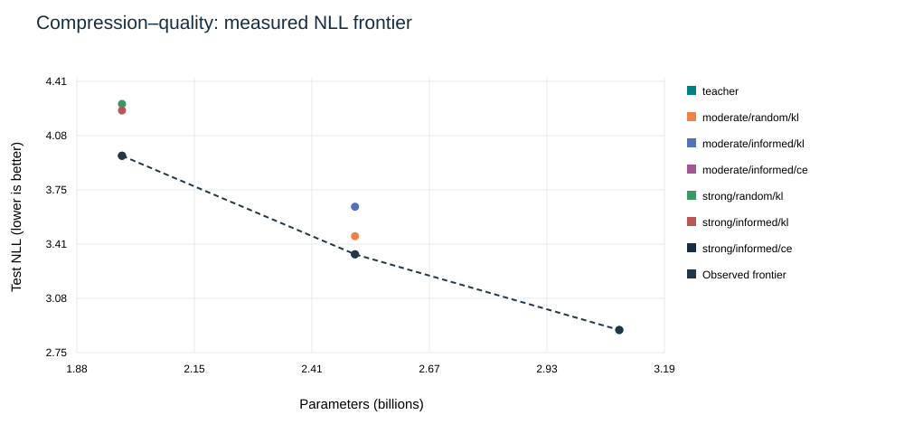

# Pruning under an 8 GiB GPU budget

**A reproducible, Minitron-inspired structured-compression and systems study—built with Qwen.**

18 matched recovery runs · 2 compression levels · 3 seeds · CPU/CUDAexecution · full-vocabularyKD · checkpointed execution

## What the measurements actually show

- Physical parameter reductions of **18.96% and 35.68%**, not quantization or sparse masks.
- **Distillation did not automatically win:** matched CE-only recovery achieved lower test perplexity at both sizes. The small KL advantage on PIQA is not a statistical-superiority claim.
- The lower-immediate-NLL criterion retained the final validation-NLL lead in **4/6** matched seed pairs—not universally.
- Real-model CPU FP32 / CUDA FP16 deployment ratios include precision effects; see the measured per-size table. On the same-weight **FP32 tiny reference, CPU was faster at every sampled size**.
- Main training peak allocation: **5.19 GiB**; maximum sampled GPU temperature: **65°C**; streamed target payload about **2.30 GiB**.

The contribution is controlled evidence and reliable engineering—not a claim of reproducing NVIDIA H100-scale quality.

## Start here
- [Technical report and measured conclusions](reports/TECHNICAL_REPORT.md)
- [All requirement evidence](reports/REQUIREMENTS_LEDGER.md)
- [Per-seed results](reports/PER_SEED_RESULTS.csv) and [paired objective/criterion effects](reports/PAIRED_EFFECTS.json)
- [CPU/GPU execution and precision disclosure](reports/CPU_GPU_DEPLOYMENT.csv)
- [12-slide presentation, PDF and speaker notes](presentation/)
- [Reproduce / resume / stop](REPRODUCE.md), [model card](MODEL_CARD.md), [data card](DATA_CARD.md)
- [Preregistered design](EXPERIMENT_PLAN.md) and [validation](reports/VALIDATION.json)

## Engineering highlights
Physical depth/FFN trimming, seed-matched CE controls, full-vocabulary logit streaming with bounded disk, low-rank recovery, atomic hash-verified checkpoints, corruption recovery tests, explicit device audits, resource guardrails, robust timing and evidence-derived reporting.

## Honest boundaries
Not an official NVIDIA reproduction, a production chatbot, a TensorRT benchmark or a claim that larger models are unnecessary. Main recovery is adapter-only and short-budget. CPU FP32/CUDA FP16 deployment ratios include precision effects; matched-FP32 tiny experiments isolate device. Three seeds do not establish universal rankings. Qwen2.5-3B has a noncommercial research license.

Large weights, optimizer states, cached targets, virtual environments and supplied copyrighted PDFs are intentionally excluded from GitHub. Exact recipes, all final adapters, raw metrics and regeneration instructions are included.