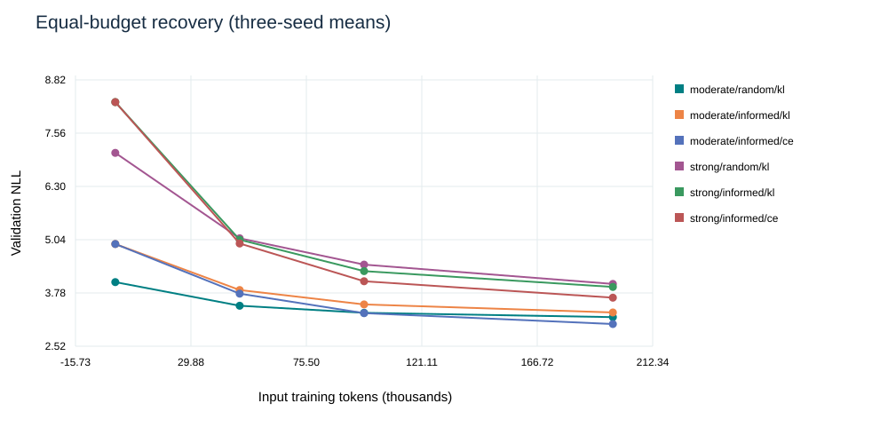
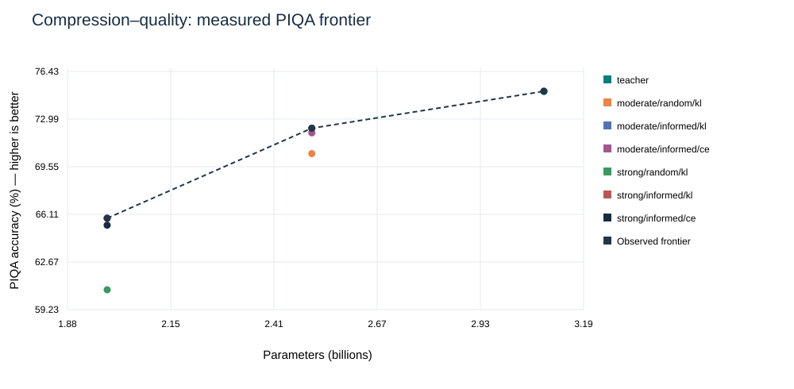
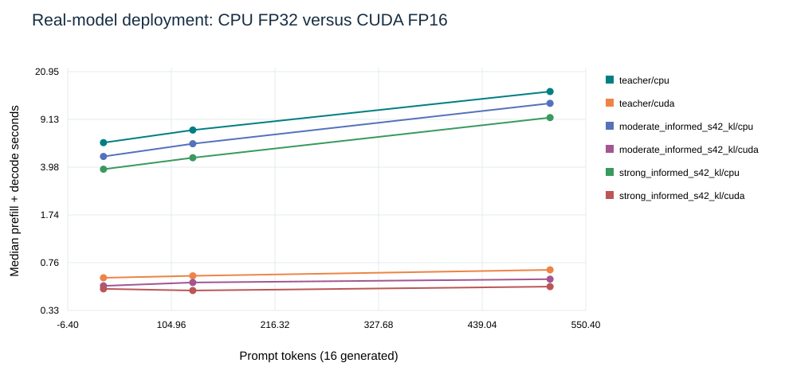
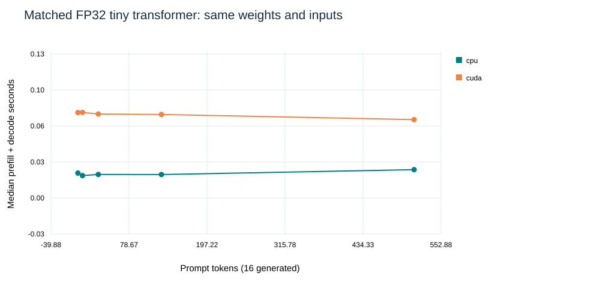
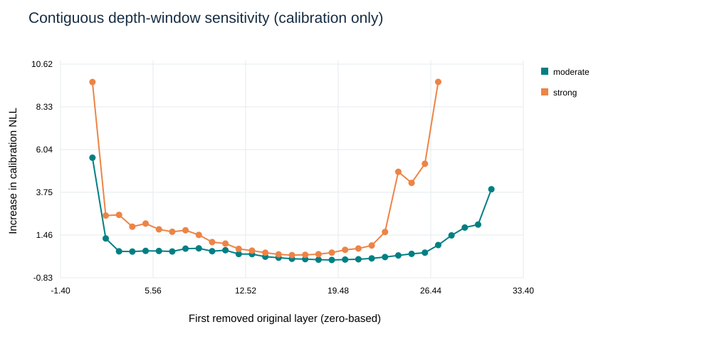
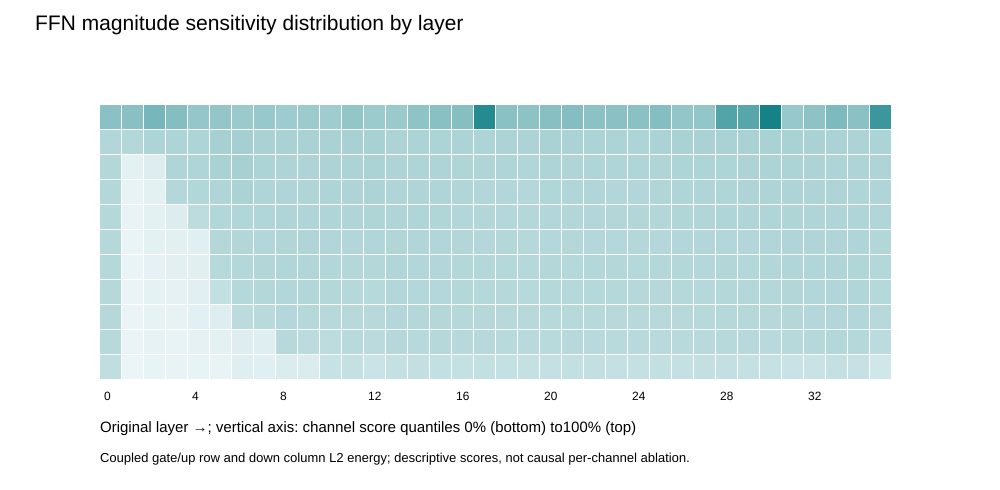

# Structured Pruning and Distillation under an 8 GiB GPU Budget

## Executive result
Executed **18 full-size recovery conditions**, two physical compression levels, three seeds, matched CE controls, CPU/CUDA references and measured workload scaling.
Teacher: 3,085,938,688 parameters; test PPL **17.95**; PIQA200 **75.0%**. These are local measurements, not NVIDIA scores.

## Scientific design
See [locked plan](../EXPERIMENT_PLAN.md), config.json and exact recipes. Every main run gets 196,608 input tokens / 195,072 causal targets and 192 updates; full-vocabulary T=2 KL or ordinary CE, same rank-8 q/v LoRA budget.
The informed depth criterion is contiguous-window calibration NLL, not the earlier pilot's individual-layer ranking. Both criteria preserve boundary layers. Random architecture and training vary with seed; informed architecture is shared and training initialization/order vary.
No automatic hyperparameter sweep or test-based checkpoint selection was performed. The exported strong/informed/seed42 model is a predeclared representative, not a claimed best model.

## Three-seed final comparison
Values are arithmetic mean ± sample SD across three seeds; no significance or population-generalization claim. PPL is mean of seed PPLs, not exp(mean NLL).

| Structure / criterion / objective | Parameters B | Reduction | Test PPL | PIQA accuracy |
|---|---:|---:|---:|---:|
| moderate/random/kl | 2.501 | 18.96% | 32.00 ± 2.41 | 70.5% ± 2.8pp |
| moderate/informed/kl | 2.501 | 18.96% | 38.26 ± 0.23 | 72.3% ± 0.6pp |
| moderate/informed/ce | 2.501 | 18.96% | 28.57 ± 0.03 | 72.0% ± 0.0pp |
| strong/random/kl | 1.985 | 35.68% | 72.68 ± 13.32 | 60.7% ± 2.5pp |
| strong/informed/kl | 1.985 | 35.68% | 69.10 ± 0.82 | 65.8% ± 0.3pp |
| strong/informed/ce | 1.985 | 35.68% | 52.32 ± 0.21 | 65.3% ± 0.3pp |

## Does minimum immediate damage predict best recovery?
Compare validation NLL before/after at the same structure and seed; downstream task ordering is a separate question. Lower NLL is better, higher PIQA is better. Do not extrapolate one criterion universally.

- **moderate, informed_minus_random_KL:** paired test ΔNLL mean +0.1808, SD 0.0829, range[+0.1176,+0.2746]; paired ΔPIQA+1.83pp. Initial validation ΔNLLs: +1.6695, -0.1955, +1.2314.
- **moderate, KL_minus_CE_informed:** paired test ΔNLL mean +0.2921, SD 0.0058, range[+0.2867,+0.2982]; paired ΔPIQA+0.33pp. Initial validation ΔNLLs: +0.0000, +0.0000, +0.0000.
- **strong, informed_minus_random_KL:** paired test ΔNLL mean -0.0397, SD 0.1680, range[-0.2218,+0.1092]; paired ΔPIQA+5.17pp. Initial validation ΔNLLs: +3.9841, -2.9802, +2.6008.
- **strong, KL_minus_CE_informed:** paired test ΔNLL mean +0.2782, SD 0.0138, range[+0.2671,+0.2936]; paired ΔPIQA+0.50pp. Initial validation ΔNLLs: +0.0000, +0.0000, +0.0000.

**Direct answer at moderate compression:** the criterion with lower immediate validation NLL also won final validation NLL in **2/3** seed pairs, final test NLL in **2/3**, and final PIQA in **1/3** (ties are retained explicitly). This describes these measured pairs, not a universal ranking law.

**Direct answer at strong compression:** the criterion with lower immediate validation NLL also won final validation NLL in **2/3** seed pairs, final test NLL in **2/3**, and final PIQA in **1/3** (ties are retained explicitly). This describes these measured pairs, not a universal ranking law.

### Controlled objective result
At both compression levels, the matched CE-only recovery achieved lower WikiText test perplexity than KL-only recovery at the same token budget. The measured KL-minus-CE mean PIQA effects span +0.33 to +0.50 percentage points; this small shared task set does not establish statistical superiority.
A distillation advantage must be established by measurements, not presumed. These experiments do not isolate why the objectives differ: finite token budget, adapter-only capacity, temperature and an uncorrected teacher are plausible hypotheses, not established causes. No post-hoc tuning or removal of unfavorable findings is performed.

The isolated KL-minus-CE contrast changes only the objective. It does not establish NVIDIA-scale teacher-correction, full-weight training or a 50× token-efficiency gain.




## CPU / GPU execution and scientific quality
Real-model CPU FP32 versus CUDA FP16 is a **deployment device+precision comparison**, not isolated hardware acceleration. Same model recipes, rounded merged weights, held-out subset and PIQA scoring are used. CPU has 4 declared threads, leaving resources for the desktop. No fallback is allowed.

This paired quality table uses the same first **16 test blocks (2,032 causal targets) and 32 PIQA examples** on both devices. The main model table instead uses 256 blocks and 200 examples. Its PPL is therefore not numerically interchangeable with this smaller, harder subset.

| Model | CPU FP32 PPL | CUDA FP16 PPL | ΔNLL GPU−CPU | CPU / GPU PIQA | Disagreements /32 |
|---|---:|---:|---:|---:|---:|
| teacher | 24.367 | 24.370 | +0.00010 | 75.0% / 75.0% | 0 |
| moderate_informed_s42_kl | 52.539 | 52.609 | +0.00134 | 62.5% / 62.5% | 0 |
| strong_informed_s42_kl | 83.040 | 82.965 | -0.00091 | 56.2% / 56.2% | 0 |

Two warmups and five synchronized timed requests per size; raw timings and IQR are retained. The request timer separates tokenization, host/device transfer, prefill+decode and output decode. Reconstruction/loading is separate. Loading is not an OS-cold-cache measurement.

| Model | Prompt→output | CPU model s | CUDA model s | Deployment model ratio | Request E2E ratio |
|---|---:|---:|---:|---:|---:|
| teacher | 32→16 | 6.096 | 0.582 | 10.48× | 10.44× |
| teacher | 128→16 | 7.589 | 0.602 | 12.61× | 12.56× |
| teacher | 512→16 | 14.822 | 0.668 | 22.19× | 22.13× |
| moderate_informed_s42_kl | 32→16 | 4.794 | 0.506 | 9.48× | 9.44× |
| moderate_informed_s42_kl | 128→16 | 5.983 | 0.536 | 11.16× | 11.11× |
| moderate_informed_s42_kl | 512→16 | 12.073 | 0.568 | 21.25× | 21.19× |
| strong_informed_s42_kl | 32→16 | 3.841 | 0.480 | 8.00× | 7.98× |
| strong_informed_s42_kl | 128→16 | 4.689 | 0.466 | 10.05× | 10.02× |
| strong_informed_s42_kl | 512→16 | 9.422 | 0.499 | 18.88× | 18.80× |

### Observed benefit scale
- moderate_informed_s42_kl: CUDA deployment request benefit observed at prompt lengths [32, 128, 512]. Already beneficial at smallest tested 32 tokens; exact crossover is below/unknown relative to sampled range.
- strong_informed_s42_kl: CUDA deployment request benefit observed at prompt lengths [32, 128, 512]. Already beneficial at smallest tested 32 tokens; exact crossover is below/unknown relative to sampled range.
- teacher: CUDA deployment request benefit observed at prompt lengths [32, 128, 512]. Already beneficial at smallest tested 32 tokens; exact crossover is below/unknown relative to sampled range.

**Clean hardware comparison:** the tiny reference uses identical learned weights and FP32 on both devices. GPU request benefit observed at sampled lengths: none; the absence of benefit is a valid result, not a failed benchmark.



## Reduced no-GPU reference
A 4-layer, 64-hidden-dimension byte-level Qwen transformer is trained on local WikiText train text; physically pruned to 3 layers / FFN 128, recovered by KL/CE on CPU and CUDA across the same three seeds. Full-weight tiny recovery is used, unlike main LoRA recovery. Complete per-seed quality, recipes, counts and timings: TINY_CPU_GPU_RESULTS.csv. Byte-level PPL must never be numerically compared to subword 3B PPL.

## Sensitivity, structural removal and Pareto frontier


Every recipe stores exact retained original layer IDs and coupled FFN IDs. Removed channels are the complement in 0..11007, not zeros/masks. FFN map shows magnitude distributions; only depth map is causal ablation sensitivity. The finite observed NLL Pareto frontier is: teacher, moderate/informed/ce, strong/informed/ce. Lines do not imply unmeasured architectures.

## Workflow cost and resource safety
Full-vocabulary targets were streamed in 64-block shards, consumed by all conditions, then their payloads removed only after durable checkpoint receipts. Payload hashes/manifests remain. No hidden-state targets or approximate top-k objective were substituted.

```json
{
  "data_preparation_seconds": 4.741960800000015,
  "target_inference_transfer_write_seconds": 198.72234450000087,
  "target_model_load_seconds": 99.33729519999997,
  "target_peak_payload_bytes": 2469871744,
  "total_teacher_targets_generated_bytes": 59276921856,
  "calibration_seconds": 85.2008896999996,
  "calibration_model_load_seconds": 7.1583402999999635,
  "main_model_execution_seconds": 6791.232850399732,
  "main_target_transfer_seconds": 442.47698319975007,
  "main_reconstruction_seconds": 1855.3022336999875,
  "main_validation_seconds": 214.9551315999979,
  "final_quality_and_generation_seconds": 517.4326456999879,
  "final_reconstruction_and_merge_seconds": 81.06404800002201,
  "model_export_write_seconds": 2.7305993999980274,
  "model_export_reconstruction_seconds": 4.667679799997131,
  "tiny_model_execution_seconds": 38.98612050001884,
  "checkpoint_seconds_approx": 305.08422459998746,
  "stage_wall_seconds": 13865.566612999994,
  "maximum_sampled_training_gpu_c": 65,
  "maximum_training_allocated_gib": 5.1937642097473145,
  "notes": [
    "Stage wall totals include process/import/monitor/IO overhead; not equal to sum of model-only timings.",
    "Checkpoint timing cumulative counter excludes the most recent write due to checkpoint serialization ordering; approximate, not exact.",
    "Power-cut/replayed steps may add wall cost; logical tokens count only committed updates.",
    "load_inclusive_first_request_seconds in raw benchmark is load plus first timed WARM request, a proxy, not measured cold-first-request latency."
  ]
}
```

See PHASE_COSTS.json and logs/stage_costs.jsonl. Stage-wall time includes Python imports, monitoring, checkpointing and other overhead, and is not reported as estimator-only time. Main execution includes forward/backward/optimizer; target transfer is timed separately. Validation costs are not folded into optimizer time. Checkpoint-time counter is approximate as disclosed.

## NVIDIA paper comparison and boundaries
- Shared principles: structural trimming, calibration ranking, random baseline, teacher-logit forward KL, token-budget recovery analysis.
- Deliberate adaptations: 3B teacher, joint depth+FFN (paper often separates depth/width), rank-8 LoRA rather than full-weight main recovery, short 128-token blocks, 196k tokens rather than 94B–380B, and no teacher correction/NAS/alignment.
- Paper reports Minitron width/depth downstream differences and teacher correction. Our measurements cannot establish those large-scale conclusions; our CE ablation only tests the local objective contrast.
- PyTorch CUDA is executed. TensorRT-LLM is conditionally excluded with official native-Windows compatibility evidence in BACKEND_SUPPORT_AUDIT.md. No TensorRT throughput claim. RAPIDS/cuML fallback: N/A.

## Limitations and threats to validity
Only three seeds, two levels, one model family, one machine and a short recovery budget. Fixed calibration, custom PIQA200 and previously disclosed WikiText test partition are not broad external validation. No semantic/near-duplicate or pretraining-contamination guarantee. Exact-block/source split checks are narrower. PIQA examples and text blocks are shared across seeds; do not treat all predictions as independent replicates. Desktop load, CPU thread budget, uncontrolled OS cache and thermal state affect timings. GPU system samples are intermittent; allocator peaks are not total board memory. CPU temperature is not available from a verified sensor. The CPU tiny reference validates mechanics/trends, not robustness of 3B training on CPU. Its 512-token prompt plus 16 generated tokens exceeds the nominal 512-position configuration; execution succeeded with rotary attention, but this is not a validated long-context quality result (see PROTOCOL_AMENDMENTS.md). No API teacher or quantization claim; parameter reduction is separated from arithmetic precision. The 3B model license is noncommercial, not Apache-2.0.

## Reproducibility, portfolio and evidence ledger
[Reproduction commands](../REPRODUCE.md), [model card](../MODEL_CARD.md), [data card](../DATA_CARD.md), [validation receipt](VALIDATION.json), [requirements ledger](REQUIREMENTS_LEDGER.md), pinned configs/recipes, all 18 final adapters and raw per-seed/per-example JSON. Saved optimizer checkpoints and STOP/RESUME commands tolerate normal interruption but cannot protect against all disk/power faults. The sealed earlier submission is preserved as the pilot, not overwritten.

## References
Sreenivas et al. (2024), LLM Pruning and Distillation in Practice: The Minitron Approach, supplied technical report; https://arxiv.org/abs/2408.11796 .
Muralidharan et al. (2024), Compact Language Models via Pruning and Knowledge Distillation; https://arxiv.org/abs/2407.14679 .
Qwen2.5-3B model card/license: https://huggingface.co/Qwen/Qwen2.5-3B .
WikiText: https://huggingface.co/datasets/Salesforce/wikitext . PIQA: https://github.com/ybisk/ybisk.github.io/tree/master/piqa .
Supplied Advanced Python HOTS & Research Project Question Bank, p. 1 and pp. 20–21; linked resources remain their owners' copyrighted materials. Do not redistribute supplied PDFs as project-authored content.